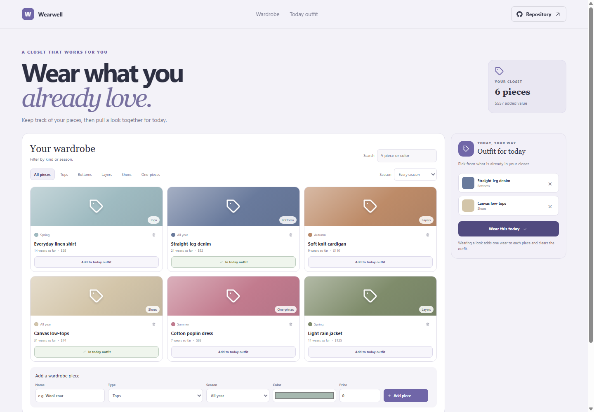

# Wearwell: Wardrobe Organizer

Wearwell gives you a simple catalog for clothing already in your closet. Filter pieces by type and season, then assemble a small outfit for today.

**GitHub Pages URL:** https://a2rp.github.io/wardrobe-organizer/ (available after deployment)

## Included

- Add wardrobe pieces with type, season, color, and optional price.
- Search and filter by item type or season.
- Choose pieces to create an outfit for today and remove individual pieces from it.
- Select Wear this today to add one wear to each piece and clear the outfit.
- Remove a wardrobe item after confirming the named piece.

## How to use it

Add a piece and choose its color, type, and season. Use the filters to browse your closet, then add pieces to the outfit for today. Select Wear this today when the look is complete.

## Data and limits

Wardrobe items and the current outfit are stored with localStorage in this browser. Wearwell does not include garment photos, cloud sync, or automatic wear tracking.

This is a browser-only utility. Clearing the browser’s site data removes its saved information.

## Run locally

~~~sh
npm install
npm run dev
~~~

## Checks and deployment

~~~sh
npm run lint
npm run build
npm run deploy
~~~

The deploy command builds the project and publishes the dist directory to the gh-pages branch. It requires the project’s public GitHub repository to be configured as origin.

## Future improvements

Ideas only. These are not implemented yet:

- Add garment photos and outfit notes.
- Track laundry status and wear dates.
- Build a calendar from saved outfits.

## Links

- Portfolio: [https://www.ashishranjan.net](https://www.ashishranjan.net)
- GitHub: [https://github.com/a2rp](https://github.com/a2rp)
- CodePen: [https://codepen.io/ash1198](https://codepen.io/ash1198)
- LinkedIn: [https://www.linkedin.com/in/aashishranjan](https://www.linkedin.com/in/aashishranjan)
- Facebook: [https://www.facebook.com/theash.ashish/](https://www.facebook.com/theash.ashish/)
- YouTube: [https://www.youtube.com/@ashishranjan-ashz?sub_confirmation=1](https://www.youtube.com/@ashishranjan-ashz?sub_confirmation=1)
- Email: [mailto:ash.ranjan09@gmail.com](mailto:ash.ranjan09@gmail.com)

## Support

- Support: [https://a2rp-donation-page.netlify.app/](https://a2rp-donation-page.netlify.app/)
- Buy Me a Coffee: [https://buymeacoffee.com/ashishranjan](https://buymeacoffee.com/ashishranjan)
- Patreon: [https://www.patreon.com/ashishranjan](https://www.patreon.com/ashishranjan)